# 🌳 Estrutura Analítica do Projeto (EAP / WBS) - Sistema de Chamados FATEC-PG

Abaixo está a representação visual da EAP dividida pelos épicos e pacotes de trabalho definidos no backlog, seguida pela sua estrutura descritiva numerada.

---

## 1. Diagrama Visual da EAP (Renderizável no GitHub)

```mermaid
flowchart TD
    %% Estilos visuais
    classDef raiz fill:#FFF3CD,stroke:#856404,stroke-width:2px,color:#000;
    classDef nivel1 fill:#FFEAA7,stroke:#D63031,stroke-width:2px,color:#000;
    classDef pacote fill:#F8F9FA,stroke:#6C5CE7,stroke-width:1.5px,color:#000;

    ROOT["<b>1.0 Sistema de Chamados FATEC-PG</b>"]:::raiz

    %% Nível 1: Grandes Entregas / Épicos
    N1["<b>1.1 Gerenciamento & Base</b>"]:::nivel1
    N2["<b>1.2 Portal do Solicitante<br/>(Épico 1)</b>"]:::nivel1
    N3["<b>1.3 Painel do Suporte<br/>(Épico 2)</b>"]:::nivel1
    N4["<b>1.4 Módulo Gerencial<br/>(Épico 2)</b>"]:::nivel1
    N5["<b>1.5 Infraestrutura & Testes</b>"]:::nivel1

    ROOT --> N1
    ROOT --> N2
    ROOT --> N3
    ROOT --> N4
    ROOT --> N5

    %% 1.1 Gerenciamento
    N1 --> T11["1.1.1 Documentação e Backlog"]:::pacote
    N1 --> T12["1.1.2 Planejamento das Sprints"]:::pacote
    N1 --> T13["1.1.3 Modelagem de Requisitos"]:::pacote

    %% 1.2 Portal do Solicitante (Épico 1)
    N2 --> T21["1.2.1 Abertura de Chamado (US01)"]:::pacote
    T21 --> T211["Formulário e Validações"]:::pacote
    T21 --> T212["Upload de Imagem/Anexo"]:::pacote
    T21 --> T213["Geração de Protocolo Único"]:::pacote

    N2 --> T22["1.2.2 Consulta de Status (US02)"]:::pacote
    T22 --> T221["Listagem com Badges"]:::pacote
    T22 --> T222["Filtros por Status e Data"]:::pacote

    N2 --> T23["1.2.3 Notificações (US03)"]:::pacote
    T23 --> T231["Disparo para @fatec.sp.gov.br"]:::pacote

    %% 1.3 Painel do Suporte (Épico 2)
    N3 --> T31["1.3.1 Atendimento Técnico (US04)"]:::pacote
    T31 --> T311["Ação de Assumir Chamado"]:::pacote
    T31 --> T312["Registro de Parecer Técnico"]:::pacote
    T31 --> T313["Controle de Acesso ao Status"]:::pacote

    N3 --> T32["1.3.2 Triagem e Fila (US05)"]:::pacote
    T32 --> T321["Ordenação por Criticidade"]:::pacote
    T32 --> T322["Alerta de Estouro de SLA (>48h)"]:::pacote

    %% 1.4 Módulo Gerencial (Épico 2)
    N4 --> T41["1.4.1 Relatórios e Indicadores (US06)"]:::pacote
    T41 --> T411["Gráfico Chamados Abertos vs Fechados"]:::pacote
    T41 --> T412["Cálculo de Tempo Médio de Resolução"]:::pacote
    T41 --> T413["Exportação de Dados em CSV/PDF"]:::pacote

    %% 1.5 Infraestrutura
    N5 --> T51["1.5.1 Banco de Dados"]:::pacote
    N5 --> T52["1.5.2 Deploy & Ambientes"]:::pacote
    N5 --> T53["1.5.3 Testes e Validação Final"]:::pacote
```

---

## 2. Estrutura Textual da EAP (Dicionário da EAP)

### **1.0 Sistema de Chamados FATEC-PG**
- **1.1 Gerenciamento & Base**
  - 1.1.1 Documentação e Backlog
  - 1.1.2 Planejamento das Sprints
  - 1.1.3 Modelagem de Requisitos
- **1.2 Portal do Solicitante (Épico 1)**
  - 1.2.1 Abertura de Chamado *(US01 - Emanuel)*
    - 1.2.1.1 Formulário com seleção de Categoria/Sala/Bloco
    - 1.2.1.2 Upload e armazenamento de imagens
    - 1.2.1.3 Gerador de número de protocolo
  - 1.2.2 Consulta e Acompanhamento *(US02 - Emanuel)*
    - 1.2.2.1 Painel com badges de status
    - 1.2.2.2 Filtro por data e status
    - 1.2.2.3 Histórico de alterações do chamado
  - 1.2.3 Notificações Automáticas *(US03 - Emanuel)*
    - 1.2.3.1 Integração de envio para e-mail `@fatec.sp.gov.br`
    - 1.2.3.2 Gatilhos de envio por alteração de status
- **1.3 Painel do Suporte e TI (Épico 2)**
  - 1.3.1 Atendimento e Resolução *(US04 - Fellipe)*
    - 1.3.1.1 Ação de assumir chamado por técnico
    - 1.3.1.2 Registro de notas técnicas e solução
    - 1.3.1.3 Regras de permissão para alteração de status
  - 1.3.2 Triagem e Fila Prioritária *(US05 - Fellipe)*
    - 1.3.2.1 Ordenação decrescente por urgência e data
    - 1.3.2.2 Alerta visual de SLA excedido (chamados > 48h)
- **1.4 Módulo Gerencial (Épico 2)**
  - 1.4.1 Relatórios e Métricas *(US06 - Fellipe)*
    - 1.4.1.1 Gráficos mensais de chamados (Abertos vs. Concluídos)
    - 1.4.1.2 Indicador de Tempo Médio de Atendimento (SLA)
    - 1.4.1.3 Exportador de relatórios em `.CSV` e `.PDF`
- **1.5 Infraestrutura & Implantação**
  - 1.5.1 Modelagem e migração de banco de dados
  - 1.5.2 Pipeline de integração contínua (CI/CD)
  - 1.5.3 Testes unitários e homologação final
